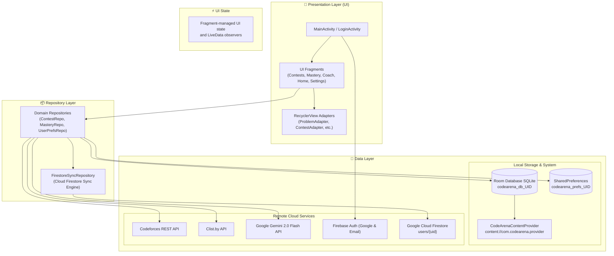

<p align="center">
  
</p>

<h1 align="center">CodeArena</h1>

<p align="center">
  <strong>⚔️ Code · Compete · Upsolve ⚔️</strong><br>
  <em>A Java Android companion for contest browsing, coding practice, profile statistics, community blogs, and spaced-review planning.</em>
</p>

<p align="center">
  <a href="#-features"></a>
  <a href="#-tech-stack"></a>
  <a href="#-tech-stack"></a>
  <a href="#-tech-stack"></a>
  <a href="#-tech-stack"></a>
  <a href="#-tech-stack"></a>
  <a href="https://github.com/MONTASIR-JOY/CodeArena/actions/workflows/build-apk.yml"></a>
</p>

---

## 📑 Table of Contents

- [✨ Overview](#-overview)
- [🔥 Core Highlights](#-core-highlights)
- [📱 Feature Showcase](#-feature-showcase)
- [☁️ Cloud Firestore & Firebase Integration](#️-cloud-firestore--firebase-integration)
- [🏗️ System Architecture](#️-system-architecture)
- [💻 Tech Stack & Libraries](#-tech-stack--libraries)
- [🎓 Academic & Syllabus Alignment (CSE 2200 / Lab 8–11)](#-academic--syllabus-alignment-cse-2200--lab-811)
- [📂 Project Directory Structure](#-project-directory-structure)
- [🚀 Getting Started & Setup](#-getting-started--setup)
- [📦 Build & Installation](#-build--installation)
- [🔒 Permissions & Security](#-permissions--security)
- [Known implementation limits](#known-implementation-limits)
- [Code audit](AUDIT_REPORT.md)
- [📜 License](#-license)

---

## ✨ Overview

**CodeArena** is a native Android app written in Java. It combines contest discovery, virtual contest screens, problem practice, Codeforces community blogs, local progress tracking, and spaced-review planning.

The app fetches public profile statistics from Codeforces, LeetCode, CodeChef, AtCoder, HackerRank, and CSES. It also includes Firebase Authentication, limited Cloud Firestore profile sync, and an optional Gemini-backed coach. See [Known implementation limits](#known-implementation-limits) and the [code audit](AUDIT_REPORT.md) for incomplete or security-sensitive areas.

---

## 🔥 Core Highlights

- Contest discovery and calendar views, including optional local reminders.
- Profile rating and solved-count summaries from supported coding platforms.
- Codeforces blogs with author/friend and read-status filters.
- Local practice tracking, a spaced-review queue, and tag-based problem browsing.
- Firebase sign-in and selected profile fields synchronized to Firestore.
- Optional Gemini-backed coaching when an API key is configured.

---

## 📱 Feature Showcase

### 1. 🏆 Virtual Contest Arena & Live Simulation
* **Virtual contest screen**: Supports in-app contest practice and analysis. The declared `ContestTimerService` and timer action receiver are scaffolds; they do not currently implement a persistent countdown or working notification actions.
* **Virtual contest practice**: Record and review practice runs. Timer and action support remains incomplete; see the audit.

### 2. 🧠 Smart Practice & Tag Mastery
* **Review queue**: Track problems for later review. Reminder and scheduling behavior has limitations described in the audit.
* **Tag Mastery with 200-Rating Brackets**: Filter unsolved problems by topic (`dp`, `greedy`, `math`, `graphs`, `data structures`, etc.) and exact 200-rating tiers:
  $$\text{800–900} \;\vert\; \text{1000–1100} \;\vert\; \text{1200–1300} \;\vert\; \dots \;\vert\; \text{2200–2300} \;\vert\; \text{2400+}$$
* **Personalized Recommender**: Selects problems right at your rating sweet-spot (+100 to +300 above your handle's current rating).
* **Home screen widget**: A `RemoteViews` widget exists, but its progress currently uses placeholder text rather than the live daily solve count.

### 3. 🤖 Google Gemini AI Algorithmic Coach
* **Progressive hints** (Gemini 2.0 Flash, when configured):
  1. 💡 *Observation & Intuition*: Highlights mathematical properties or subtle invariants.
  2. 🧭 *Algorithmic Direction*: Points toward the correct data structure or reduction (e.g., segment tree, DP state definition).
  3. 📝 *Pseudocode & Complexity*: Full algorithmic outline and complexity breakdown when completely stuck.
* Coach output depends on the configured Gemini API key and current app implementation.

### 4. 🌐 Multi-Platform Aggregation & Community
* **Platform profile summaries**: Codeforces, LeetCode, CodeChef, AtCoder, HackerRank, and CSES. Available metrics vary by platform and public endpoint.
* **Handle editing**: Update supported handles on Home or Settings; updates are sent to Firestore when signed in.
* **Contest calendar**: Combines Codeforces and Clist-backed contest data. Reminders are scheduled for 30 minutes before a contest; Android may use an inexact alarm when exact-alarm access is unavailable.
* **Codeforces Blogs & Topic Catalogs**: Full markdown and interactive reader for community tutorials and educational catalogs with read/unread tracking.
* **Friends and blog filters**: Review friend-authored Codeforces blogs with read/unread filters.

### 5. 🛡️ Multi-Account Isolation & Content Provider
* **Dynamic Scoping**: Every user who logs in with Google or Email/Password gets an isolated environment:
  - Local SQLite Database: `codearena_db_<uid>.db`
  - SharedPreferences: `codearena_preferences_<uid>.xml`
* Per-user local storage is selected based on the signed-in account. Guest data migration behavior depends on the current app flow.
* **ContentProvider**: Structured URIs exist for local records, but the provider is now private to the app (`exported=false`).

---

## ☁️ Cloud Firestore & Firebase Integration

CodeArena syncs the signed-in profile to `users/{uid}` via `FirestoreSyncRepository.java`. Sync is limited to profile data and user preferences; Room records and API credentials are not uploaded.

The profile document stores all six platform handles and solved counts, current ratings (Codeforces, LeetCode, CodeChef, AtCoder), peak ratings (LeetCode, CodeChef, AtCoder), friends, blog/catalog read IDs, daily target, notification/theme settings, and an update timestamp. The app restores these fields at sign-in and keeps local profile changes synced. Failed reads now return a sync failure; only a successful read confirming a missing document initializes it.

### Automatic Sync Triggers
* **On Sign-In / Login**: the app restores the saved profile, or initializes it after a successful read confirms that no document exists.
* **On Profile/Preference Changes**: configured handles, platform statistics, friends, reading state, and synced preferences are uploaded.

### Cloud Firestore Security Rules
Publish the checked-in [`firestore.rules`](firestore.rules) to the target Firebase project. They restrict access to the authenticated owner's document and validate the profile schema, field types, handle lengths, counters, and collection sizes. Avoid replacing them with broad signed-in-user access.

---

## 🏗️ System Architecture

The app uses an Activity and Fragment UI with repository and data layers. The audit found no Jetpack ViewModel classes, so this README does not describe the project as MVVM.



---

## 💻 Tech Stack & Libraries

| Category | Technology | Usage / Purpose |
| :--- | :--- | :--- |
| **Language** | **Java (Java 8 / JDK 17)** | 100% native Java implementation (0 Kotlin) |
| **Platform** | **Android SDK (API 26 – 35 / Android 15)** | Android 8.0 Oreo up to Android 15 with Edge-to-Edge support |
| **Architecture** | **Activity/Fragments + Repositories** | UI and data access organized across feature fragments and repositories |
| **UI Design** | **Material 3 & Edge-to-Edge** | Unified bold typography (`sans-serif-black`), Edge-to-Edge insets, dynamic color |
| **View Binding** | **Android ViewBinding** | Compile-time type-safe layout binding |
| **Navigation** | **Jetpack Navigation Component** | Single-Activity architecture (`NavHostFragment`) |
| **Local Database** | **AndroidX Room 2.5.2** | SQLite abstraction, DAOs, TypeConverters, Entities |
| **Cloud Database** | **Google Cloud Firestore** | Sync for selected profile fields |
| **Networking** | **Retrofit 2 + OkHttp 3** | HTTP REST communication with interceptors and rate limiters |
| **Serialization** | **Google Gson 2.9.0** | Robust JSON parsing and serialization |
| **Authentication** | **Firebase Auth + Google Play Services** | Secure authentication and Google One-Tap Sign-In |
| **Generative AI** | **Google Gemini 2.0 Flash API** | Optional AI Coach; credentials are only supported in local debug builds until a backend proxy exists |
| **System Services** | **Foreground Service & AlarmManager** | Contest timer service is a scaffold; contest reminders can fall back to inexact alarms |
| **Content Provider** | **Android ContentProvider** | Internal app provider for local records; not exported |
| **Widgets** | **AppWidgetProvider / RemoteViews** | Home-screen widget currently displays placeholder progress |

---

## 🎓 Academic & Syllabus Alignment (CSE 2200 / Lab 8–11)

This project was built to fulfill and exceed the requirements of **CSE 2200: Advanced Programming Laboratory**:

| Syllabus Module | Lab Topic / Requirement | CodeArena Implementation |
| :--- | :--- | :--- |
| **Language Standards** | Pure Java (No Kotlin) | **100% Java** across all source files and repositories. |
| **Lab 8: Android Basics & Navigation** | Manifest, Activity Lifecycle, Explicit/Implicit Intents, View Binding | • Multi-Activity navigation (`LoginActivity` ↔ `MainActivity`)<br>• Explicit and implicit intents for external links & sharing<br>• Type-safe Android View Binding used in 100% of layouts. |
| **Lab 9: UI & Lists** | Layout Design, `RecyclerView`, Custom Adapters, ViewHolders | • `ConstraintLayout`, `LinearLayout`, `CoordinatorLayout`<br>• Dynamic lists with custom adapters (`ContestAdapter`, `ProblemAdapter`, `MasteryAdapter`, `FriendAdapter`, `BlogAdapter`, `UpcomingContestAdapter`). |
| **Lab 10: Android Components** | **Services**, **Broadcast Receivers**, **Content Providers**, Permissions | • `ContestTimerService` scaffold<br>• `ContestAlarmReceiver` and `BootReceiver` for contest reminders<br>• Private `CodeArenaContentProvider` for app-owned records<br>• Runtime notification permission and exact-alarm access handling. |
| **Lab 11: Networking & Databases** | REST APIs, **JSON Parsing**, **SQLite**, **Firebase Services** | • Retrofit and Gson for platform APIs<br>• Room ORM (SQLite) with per-user databases<br>• Firebase Authentication (Google Sign-In and Email/Password)<br>• Firestore sync for selected profile data. |
| **Concurrency & Threading** | Multithreading, `ExecutorService` | Java `Executors.newSingleThreadExecutor()` and `databaseWriteExecutor` for non-blocking asynchronous operations. |

---

## 📂 Project Directory Structure

```
d:/CodeArena/
├── app/
│   ├── src/main/
│   │   ├── AndroidManifest.xml
│   │   ├── java/com/codearena/
│   │   │   ├── CodeArenaApp.java                # Application initialization
│   │   │   ├── MainActivity.java                # Single-activity host for nav graph
│   │   │   ├── data/
│   │   │   │   ├── api/                         # Retrofit API clients & interceptors
│   │   │   │   ├── db/                          # Room DB, DAOs & Entities
│   │   │   │   ├── model/                       # Data transfer objects (DTOs)
│   │   │   │   ├── provider/                    # CodeArenaContentProvider
│   │   │   │   └── repository/                  # Repositories & FirestoreSyncRepository
│   │   │   ├── receiver/                        # BootReceiver & ContestAlarmReceiver
│   │   │   ├── service/                         # Foreground ContestTimerService
│   │   │   ├── ui/                              # Feature UI modules
│   │   │   │   ├── adapter/                     # RecyclerView adapters & view holders
│   │   │   │   ├── analysis/                    # Post-contest performance analysis
│   │   │   │   ├── analytics/                   # Performance charts & stats
│   │   │   │   ├── auth/                        # LoginActivity & Google Auth
│   │   │   │   ├── blogs/                       # CF blogs reader & detail view
│   │   │   │   ├── calendar/                    # Interactive contest calendar
│   │   │   │   ├── catalog/                     # Codeforces catalog explorer
│   │   │   │   ├── coach/                       # AI progressive hints & training plans
│   │   │   │   ├── contestdetail/               # Problem list & contest overview
│   │   │   │   ├── contests/                    # Main contest browser
│   │   │   │   ├── daily/                       # Daily challenge view
│   │   │   │   ├── friends/                     # Friend ratings & blog tracker
│   │   │   │   ├── history/                     # History of virtual contest runs
│   │   │   │   ├── home/                        # Main dashboard & active metrics
│   │   │   │   ├── live/                        # Live contest arena with timer
│   │   │   │   ├── mastery/                     # Tag Mastery with 200-rating intervals
│   │   │   │   ├── recommender/                 # Smart problem recommendations
│   │   │   │   ├── settings/                    # Handles, credentials & preferences
│   │   │   │   └── upcoming/                    # Clist.by aggregated upcoming rounds
│   │   │   ├── util/                            # Rating calculations & algorithms
│   │   │   └── widget/                          # Android home screen widget provider
│   │   └── res/                                 # Drawables, layouts, mipmaps & navigation
│   └── build.gradle.kts                         # App module build configuration
├── gradle/                                      # Gradle wrapper files
├── build.gradle.kts                             # Root project build configuration
├── settings.gradle.kts                          # Module inclusion configuration
└── README.md
```

---

## 🚀 Getting Started & Setup

### 1. Clone the Repository
```bash
git clone https://github.com/MONTASIR-JOY/CodeArena-kt.git
cd CodeArena
```

### 2. Configure `local.properties`
Create a `local.properties` file in the project root. Keys configured here are embedded in local debug APKs and can be extracted. Release builds and GitHub Actions builds leave these keys blank; use a trusted backend proxy before enabling Gemini/Clist credentials in a distributed release.
```properties
sdk.dir=C:\\Users\\YourUsername\\AppData\\Local\\Android\\Sdk

# Debug builds only. These values are embedded and extractable; never publish a debug APK containing real keys.
# Release/CI builds intentionally leave provider keys blank.
# Optional: Google Gemini API Key for AI Coaching
GEMINI_API_KEY=your_gemini_api_key_here

# Optional: Clist.by credentials for multi-platform contest scraping
CLIST_USERNAME=your_clist_username
CLIST_API_KEY=your_clist_api_key
```

### 3. Configure Firebase Authentication & Cloud Firestore
1. Open the [Firebase Console](https://console.firebase.google.com/) and create a project.
2. Under **Authentication**, enable **Google Sign-In** and **Email/Password**.
3. Under **Firestore Database**, create a database and publish the security rules:
   Publish the checked-in `firestore.rules` file. It validates the owner-scoped profile schema.
4. Register your Android app package `com.codearena` and add your SHA-1 signing fingerprint.
5. Download `google-services.json` and place it in the `app/` directory.

---

## 📦 Build & Installation

### Build via Gradle
```bash
# Generate debug APK
./gradlew assembleDebug

# Clean build
./gradlew clean assembleDebug
```

### Deploy to Connected Device via ADB
```bash
adb install -r app/build/outputs/apk/debug/app-debug.apk
adb shell monkey -p com.codearena 1
```

---

## 🔒 Permissions & Security

| Permission | Purpose |
| :--- | :--- |
| `android.permission.INTERNET` | Communicating with Codeforces, Clist, Firebase, Cloud Firestore, and Gemini APIs |
| `android.permission.ACCESS_NETWORK_STATE` | Monitoring active network connectivity |
| `android.permission.FOREGROUND_SERVICE` | Foreground service declaration; timer behavior is currently a scaffold |
| `android.permission.SCHEDULE_EXACT_ALARM` | Exact reminder scheduling when access is available; otherwise app can use an inexact alarm |
| `android.permission.POST_NOTIFICATIONS` | Delivering contest countdowns and reminder alerts (Android 13+) |
| `android.permission.RECEIVE_BOOT_COMPLETED` | Restoring alarms automatically upon device restart |

---

## Known implementation limits

- Provider API credentials are available only to local debug builds, where they remain extractable; release and CI APKs omit them. A backend proxy is needed to enable these services securely in releases.
- Firestore sync covers the profile fields listed above, not Room database records. Firebase Console data and deployed rules were not inspected in this static audit.
- Milestone alerts, upsolve reminders, timer actions, and live widget progress are incomplete or unimplemented.
- Destructive Room fallback is removed. Future schema changes need explicit Room migrations to keep existing data.

See [AUDIT_REPORT.md](AUDIT_REPORT.md) for evidence, impact, and recommended fixes.

---

## 📜 License

No `LICENSE` file is currently checked into this repository. Add a license file before redistributing the project.

<p align="center">
  Made with ❤️ for Competitive Programmers worldwide.
</p>
