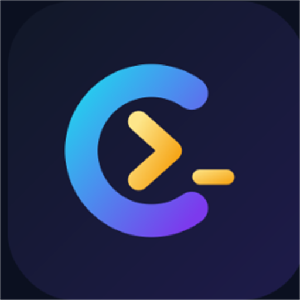
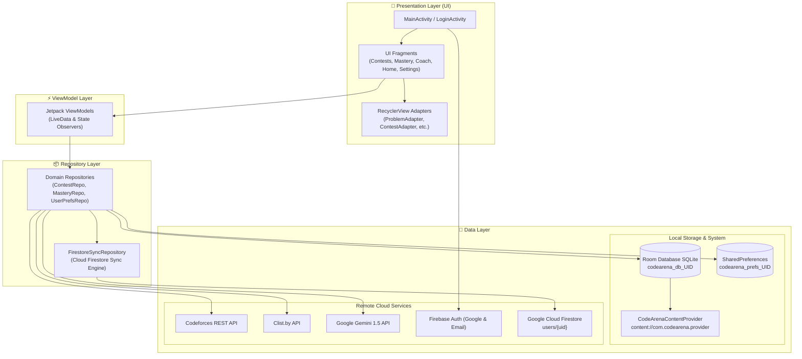

<p align="center">
  
</p>

<h1 align="center">CodeArena</h1>

<p align="center">
  <strong>⚔️ Code · Compete · Upsolve ⚔️</strong><br>
  <em>The ultimate competitive programming companion for Android — with live virtual contest simulation, spaced-repetition upsolving, multi-platform tracking, Cloud Firestore sync, and AI-powered coaching.</em>
</p>

<p align="center">
  <a href="#-features"></a>
  <a href="#-tech-stack"></a>
  <a href="#-tech-stack"></a>
  <a href="#-tech-stack"></a>
  <a href="#-tech-stack"></a>
  <a href="#-tech-stack"></a>
  
</p>

---

## 📑 Table of Contents

- [✨ Overview](#-overview)
- [🔥 Core Highlights](#-core-highlights)
- [📱 Feature Showcase](#-feature-showcase)
- [☁️ Cloud Firestore & Firebase Integration](#️-cloud-firestore--firebase-integration)
- [🏗️ System Architecture](#️-system-architecture)
- [💻 Tech Stack & Libraries](#-tech-stack--libraries)
- [🎓 Academic & Syllabus Alignment (CSE 2200 / Lab 8–11)](#-academic--syllabus-alignment-cse-2200--lab-811)
- [📂 Project Directory Structure](#-project-directory-structure)
- [🚀 Getting Started & Setup](#-getting-started--setup)
- [📦 Build & Installation](#-build--installation)
- [🔒 Permissions & Security](#-permissions--security)
- [📜 License](#-license)

---

## ✨ Overview

**CodeArena** is a production-grade, native Android application engineered in **pure Java** to empower competitive programmers. Whether you are aiming for *Candidate Master* on Codeforces, solving algorithmic challenges on LeetCode, or preparing for high-stakes technical coding rounds, **CodeArena** unifies your entire training workflow into a single, high-performance ecosystem.

It bridges multi-platform contest tracking (**Codeforces, AtCoder, CodeChef, LeetCode, HackerRank**), offers real-time virtual contest simulation with custom background services, enforces long-term mastery via spaced repetition, provides bidirectional **Cloud Firestore** profile synchronization, and introduces an interactive **Gemini AI Coach** that guides you algorithmically without spoiling solutions.

---

## 🔥 Core Highlights

```
   ┌────────────────────────────────────────────────────────────────────────┐
   │                               CodeArena                                │
   ├───────────────────┬───────────────────┬────────────────────────────────┤
   │ 🏆 Virtual Arena  │ 🧠 Upsolve System │ 🤖 Gemini AI Coach             │
   │  • Live timer     │  • Spaced Rep     │  • 3-tier hints                │
   │  • Rank estimate  │  • Tag mastery    │  • Code review                 │
   │  • Post-analysis  │  • 200-step chips │  • 7-day training plan         │
   ├───────────────────┼───────────────────┼────────────────────────────────┤
   │ 🌐 Multi-Platform │ ☁️ Cloud Sync     │ 🛡️ Multi-Account Security      │
   │  • Clist & CF API │  • Firestore DB   │  • Firebase + Google Sign-In   │
   │  • 5 platforms    │  • Live handles   │  • User-scoped DB isolation    │
   │  • Solve counts   │  • Solve counts   │  • ContentProvider sharing     │
   └───────────────────┴───────────────────┴────────────────────────────────┘
```

---

## 📱 Feature Showcase

### 1. 🏆 Virtual Contest Arena & Live Simulation
* **Live Timer Service**: Runs as a persistent Android **Foreground Service** (`ContestTimerService`) with notification tray updates and interactive actions, keeping countdowns uninterrupted even if the screen turns off or the app is minimized.
* **Realistic Rank & Rating Estimator**: Evaluates penalty and solve times against historical contest distributions to predict your virtual rank and delta.
* **Deep Post-Contest Analysis**: Immediate breakdowns of problems solved, penalties incurred, tag distributions, and upsolving gaps.

### 2. 🧠 Smart Practice & Tag Mastery
* **Spaced Repetition Upsolving**: Automatically schedules missed problems for review along standard retention curves (Day 1, 3, 7, 14, 30).
* **Tag Mastery with 200-Rating Brackets**: Filter unsolved problems by topic (`dp`, `greedy`, `math`, `graphs`, `data structures`, etc.) and exact 200-rating tiers:
  $$\text{800–900} \;\vert\; \text{1000–1100} \;\vert\; \text{1200–1300} \;\vert\; \dots \;\vert\; \text{2200–2300} \;\vert\; \text{2400+}$$
* **Personalized Recommender**: Selects problems right at your rating sweet-spot (+100 to +300 above your handle's current rating).
* **Home Screen Daily Widget**: Maintain daily coding streaks right from your device's home screen via `AppWidgetProvider`.

### 3. 🤖 Google Gemini AI Algorithmic Coach
* **3-Tier Progressive Hints**:
  1. 💡 *Observation & Intuition*: Highlights mathematical properties or subtle invariants.
  2. 🧭 *Algorithmic Direction*: Points toward the correct data structure or reduction (e.g., segment tree, DP state definition).
  3. 📝 *Pseudocode & Complexity*: Full algorithmic outline and complexity breakdown when completely stuck.
* **Intelligent Code Review**: Inspects your Java/C++/Python code to identify $O(N^2)$ pitfalls, memory bloat, and unhandled corner cases.
* **7-Day Dynamic Training Plan**: Synthesizes your historical weaknesses into an actionable 7-day schedule.

### 4. 🌐 Multi-Platform Aggregation & Community
* **Unified 5-Platform Support**: Track handles and live solve statistics across **Codeforces, LeetCode, CodeChef, AtCoder, and HackerRank**.
* **1-Tap Handle Editing**: Tap any platform badge directly on the Home screen or in Settings to update your handle and instantly sync it to Cloud Firestore.
* **Contest Calendar & Clist.by Integration**: Aggregates upcoming rated contests across competitive sites with local `AlarmManager` reminders.
* **Codeforces Blogs & Topic Catalogs**: Full markdown and interactive reader for community tutorials and educational catalogs with read/unread tracking.
* **Friends Radar**: Monitor your peers' rating graphs, compare head-to-head solve statistics, and read blogs authored by friends.

### 5. 🛡️ Multi-Account Isolation & Content Provider
* **Dynamic Scoping**: Every user who logs in with Google or Email/Password gets an isolated environment:
  - Local SQLite Database: `codearena_db_<uid>.db`
  - SharedPreferences: `codearena_preferences_<uid>.xml`
* **Auto-Migration**: Any handle entered in guest mode automatically migrates to your Google account upon sign-in.
* **CodeArenaContentProvider**: Exposes structured inter-app URIs (`content://com.codearena.provider/contests`, `/problems`, `/virtual_runs`, `/upsolve`) using Android's native `ContentProvider` component.

---

## ☁️ Cloud Firestore & Firebase Integration

CodeArena includes complete bidirectional synchronization with **Google Cloud Firestore** under collection `users/{uid}` via `FirestoreSyncRepository.java`.

### Document Schema in Cloud Firestore
```json
{
  "uid": "d98FhK2l9LmP4vQ...",
  "email": "user@gmail.com",

  "handles": {
    "codeforces": "tourist",
    "leetcode": "user_lc",
    "codechef": "user_cc",
    "atcoder": "chokudai",
    "hackerrank": "user_hr"
  },

  "solvedCounts": {
    "codeforces": 132,
    "leetcode": 345,
    "codechef": 85,
    "atcoder": 48,
    "hackerrank": 62
  },

  "codeforcesHandle": "tourist",
  "leetcodeHandle": "user_lc",
  "codechefHandle": "user_cc",
  "atcoderHandle": "chokudai",
  "hackerrankHandle": "user_hr",

  "rating": 1640,
  "readBlogIds": [101, 102],
  "readCatalogIds": [1, 2],
  "lastUpdated": 1731002594000
}
```

### Automatic Sync Triggers
* **On Sign-In / Login**: `pullFromFirestore()` automatically pulls and restores all 5 handles, solve counts, and reading progress.
* **On Handle Update**: Tapping any platform badge on Home or updating in Settings triggers an immediate push to Firestore.
* **On Daily Solve Count Refresh**: As live solve numbers update from platform APIs, Firestore is refreshed with `SetOptions.merge()`.
* **On Rating Change**: When a new Codeforces rating is calculated after a contest, it is synced to Firestore.

### Cloud Firestore Security Rules
In the [Firebase Console](https://console.firebase.google.com/) under **Firestore Database → Rules**, publish:
```javascript
rules_version = '2';
service cloud.firestore {
  match /databases/{database}/documents {
    match /{document=**} {
      allow read, write: if request.auth != null;
    }
  }
}
```

---

## 🏗️ System Architecture

CodeArena adheres to modern **Android Jetpack MVVM (Model-View-ViewModel)** guidelines with strict separation of concerns:



---

## 💻 Tech Stack & Libraries

| Category | Technology | Usage / Purpose |
| :--- | :--- | :--- |
| **Language** | **Java (Java 8 / JDK 17)** | 100% native Java implementation (0 Kotlin) |
| **Platform** | **Android SDK (API 26 – 34)** | Android 8.0 Oreo up to Android 14 UpsideDownCake |
| **Architecture** | **MVVM + Repositories** | Decoupled, lifecycle-aware architecture |
| **UI Components** | **Google Material Design 3** | MaterialCardView, ChipGroups, LinearProgressIndicator |
| **View Binding** | **Android ViewBinding** | Compile-time type-safe layout binding |
| **Navigation** | **Jetpack Navigation Component** | Single-Activity architecture (`NavHostFragment`) |
| **Local Database** | **AndroidX Room 2.5.2** | SQLite abstraction, DAOs, TypeConverters, Entities |
| **Cloud Database** | **Google Cloud Firestore 24.11+** | Real-time cloud synchronization for handles, solve counts & bookmarks |
| **Networking** | **Retrofit 2 + OkHttp 3** | HTTP REST communication with interceptors and rate limiters |
| **Serialization** | **Google Gson 2.9.0** | Robust JSON parsing and serialization |
| **Authentication** | **Firebase Auth + Google Play Services** | Secure authentication and Google One-Tap Sign-In |
| **Generative AI** | **Google Gemini 1.5 API** | AI Coach for progressive hints, reviews, and training plans |
| **System Services** | **Foreground Service & AlarmManager** | Background contest timer & exact reminder notifications |
| **Content Provider** | **Android ContentProvider** | Inter-app data sharing via `CodeArenaContentProvider` |
| **Widgets** | **Android AppWidgetProvider** | Home screen daily challenge glance widget |

---

## 🎓 Academic & Syllabus Alignment (CSE 2200 / Lab 8–11)

This project was built to fulfill and exceed the requirements of **CSE 2200: Advanced Programming Laboratory**:

| Syllabus Module | Lab Topic / Requirement | CodeArena Implementation |
| :--- | :--- | :--- |
| **Language Standards** | Pure Java (No Kotlin) | **100% Java** across all source files and repositories. |
| **Lab 8: Android Basics & Navigation** | Manifest, Activity Lifecycle, Explicit/Implicit Intents, View Binding | • Multi-Activity navigation (`LoginActivity` ↔ `MainActivity`)<br>• Explicit and implicit intents for external links & sharing<br>• Type-safe Android View Binding used in 100% of layouts. |
| **Lab 9: UI & Lists** | Layout Design, `RecyclerView`, Custom Adapters, ViewHolders | • `ConstraintLayout`, `LinearLayout`, `CoordinatorLayout`<br>• Dynamic lists with custom adapters (`ContestAdapter`, `ProblemAdapter`, `MasteryAdapter`, `FriendAdapter`, `BlogAdapter`, `UpcomingContestAdapter`). |
| **Lab 10: Android Components** | **Services**, **Broadcast Receivers**, **Content Providers**, Permissions | • `ContestTimerService` (Foreground service with ongoing notification tray updates)<br>• `ContestAlarmReceiver`, `BootReceiver`, `TimerActionReceiver`<br>• `CodeArenaContentProvider` for structured content sharing<br>• Runtime permission handling (`POST_NOTIFICATIONS`, `SCHEDULE_EXACT_ALARM`). |
| **Lab 11: Networking & Databases** | REST APIs, **JSON Parsing**, **SQLite**, **Firebase Services** | • Retrofit 2 + Gson for external REST APIs (Codeforces & Clist.by)<br>• Room ORM (SQLite) with multi-account isolation (`codearena_db_<uid>.db`)<br>• **Firebase Authentication** (Google Sign-In & Email/Password)<br>• **Cloud Firestore** (`users/{uid}`) syncing 5-platform handles and solve counts. |
| **Concurrency & Threading** | Multithreading, `ExecutorService` | Java `Executors.newSingleThreadExecutor()` and `databaseWriteExecutor` for non-blocking asynchronous operations. |

---

## 📂 Project Directory Structure

```
d:/CodeArena/
├── app/
│   ├── src/main/
│   │   ├── AndroidManifest.xml
│   │   ├── java/com/codearena/
│   │   │   ├── CodeArenaApp.java                # Application initialization
│   │   │   ├── MainActivity.java                # Single-activity host for nav graph
│   │   │   ├── data/
│   │   │   │   ├── api/                         # Retrofit API clients & interceptors
│   │   │   │   ├── db/                          # Room DB, DAOs & Entities
│   │   │   │   ├── model/                       # Data transfer objects (DTOs)
│   │   │   │   ├── provider/                    # CodeArenaContentProvider
│   │   │   │   └── repository/                  # Repositories & FirestoreSyncRepository
│   │   │   ├── receiver/                        # BootReceiver & ContestAlarmReceiver
│   │   │   ├── service/                         # Foreground ContestTimerService
│   │   │   ├── ui/                              # Feature UI modules
│   │   │   │   ├── adapter/                     # RecyclerView adapters & view holders
│   │   │   │   ├── analysis/                    # Post-contest performance analysis
│   │   │   │   ├── analytics/                   # Performance charts & stats
│   │   │   │   ├── auth/                        # LoginActivity & Google Auth
│   │   │   │   ├── blogs/                       # CF blogs reader & detail view
│   │   │   │   ├── calendar/                    # Interactive contest calendar
│   │   │   │   ├── catalog/                     # Codeforces catalog explorer
│   │   │   │   ├── coach/                       # AI progressive hints & training plans
│   │   │   │   ├── contestdetail/               # Problem list & contest overview
│   │   │   │   ├── contests/                    # Main contest browser
│   │   │   │   ├── daily/                       # Daily challenge view
│   │   │   │   ├── friends/                     # Friend ratings & blog tracker
│   │   │   │   ├── history/                     # History of virtual contest runs
│   │   │   │   ├── home/                        # Main dashboard & active metrics
│   │   │   │   ├── live/                        # Live contest arena with timer
│   │   │   │   ├── mastery/                     # Tag Mastery with 200-rating intervals
│   │   │   │   ├── recommender/                 # Smart problem recommendations
│   │   │   │   ├── settings/                    # Handles, credentials & preferences
│   │   │   │   └── upcoming/                    # Clist.by aggregated upcoming rounds
│   │   │   ├── util/                            # Rating calculations & algorithms
│   │   │   └── widget/                          # Android home screen widget provider
│   │   └── res/                                 # Drawables, layouts, mipmaps & navigation
│   └── build.gradle.kts                         # App module build configuration
├── gradle/                                      # Gradle wrapper files
├── build.gradle.kts                             # Root project build configuration
├── settings.gradle.kts                          # Module inclusion configuration
└── README.md
```

---

## 🚀 Getting Started & Setup

### 1. Clone the Repository
```bash
git clone https://github.com/MONTASIR-JOY/CodeArena.git
cd CodeArena
```

### 2. Configure `local.properties`
Create a `local.properties` file in the project root:
```properties
sdk.dir=C:\\Users\\YourUsername\\AppData\\Local\\Android\\Sdk

# Optional: Google Gemini API Key for AI Coaching
GEMINI_API_KEY=your_gemini_api_key_here

# Optional: Clist.by credentials for multi-platform contest scraping
CLIST_USERNAME=your_clist_username
CLIST_API_KEY=your_clist_api_key
```

### 3. Configure Firebase Authentication & Cloud Firestore
1. Open the [Firebase Console](https://console.firebase.google.com/) and create a project.
2. Under **Authentication**, enable **Google Sign-In** and **Email/Password**.
3. Under **Firestore Database**, create a database and publish the security rules:
   ```javascript
   rules_version = '2';
   service cloud.firestore {
     match /databases/{database}/documents {
       match /{document=**} {
         allow read, write: if request.auth != null;
       }
     }
   }
   ```
4. Register your Android app package `com.codearena` and add your SHA-1 signing fingerprint.
5. Download `google-services.json` and place it in the `app/` directory.

---

## 📦 Build & Installation

### Build via Gradle
```bash
# Generate debug APK
./gradlew assembleDebug

# Clean build
./gradlew clean assembleDebug
```

### Deploy to Connected Device via ADB
```bash
# Stream install APK
adb install -r app/build/outputs/apk/debug/app-debug.apk

# Launch Login Activity
adb shell am start -n com.codearena/.ui.auth.LoginActivity
```

---

## 🔒 Permissions & Security

| Permission | Purpose |
| :--- | :--- |
| `android.permission.INTERNET` | Communicating with Codeforces, Clist, Firebase, Cloud Firestore, and Gemini APIs |
| `android.permission.ACCESS_NETWORK_STATE` | Monitoring active network connectivity |
| `android.permission.FOREGROUND_SERVICE` | Maintaining live virtual contest timers in the foreground |
| `android.permission.SCHEDULE_EXACT_ALARM` | Scheduling precise contest reminders via AlarmManager |
| `android.permission.POST_NOTIFICATIONS` | Delivering contest countdowns and reminder alerts (Android 13+) |
| `android.permission.RECEIVE_BOOT_COMPLETED` | Restoring alarms automatically upon device restart |

---

## 📜 License

Distributed under the **Apache License 2.0**.

<p align="center">
  Made with ❤️ for Competitive Programmers worldwide.
</p>
