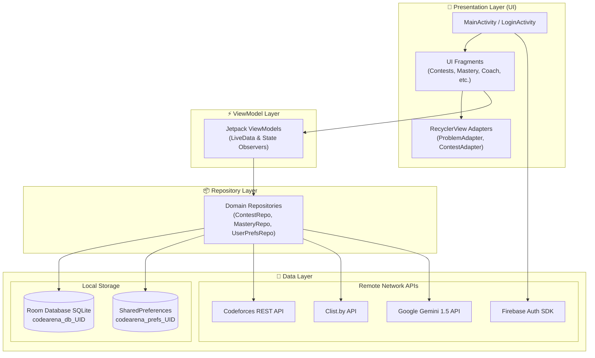

<p align="center">
  
</p>

<h1 align="center">CodeArena</h1>

<p align="center">
  <strong>⚔️ Code · Compete · Upsolve ⚔️</strong><br>
  <em>The ultimate competitive programming companion for Android — with live virtual contest simulation, spaced-repetition upsolving, multi-platform tracking, and AI-powered coaching.</em>
</p>

<p align="center">
  <a href="#-features"></a>
  <a href="#-tech-stack"></a>
  <a href="#-tech-stack"></a>
  <a href="#-tech-stack"></a>
  <a href="#-tech-stack"></a>
  <a href="#-tech-stack"></a>
  
</p>

---

## 📑 Table of Contents

- [✨ Overview](#-overview)
- [🔥 Core Highlights](#-core-highlights)
- [📱 Feature Showcase](#-feature-showcase)
- [🏗️ System Architecture](#️-system-architecture)
- [💻 Tech Stack & Libraries](#-tech-stack--libraries)
- [🎓 Academic & Syllabus Alignment (CSE 2200)](#-academic--syllabus-alignment-cse-2200)
- [📂 Project Directory Structure](#-project-directory-structure)
- [🚀 Getting Started & Setup](#-getting-started--setup)
- [📦 Build & Installation](#-build--installation)
- [🔒 Permissions & Security](#-permissions--security)
- [📜 License](#-license)

---

## ✨ Overview

**CodeArena** is a production-grade, native Android application engineered in **pure Java** to empower competitive programmers. Whether you are aiming for *Candidate Master* on Codeforces or preparing for algorithmic coding rounds, **CodeArena** unifies your entire training workflow into a single, high-performance ecosystem.

It bridges multi-platform contest tracking (**Codeforces, AtCoder, CodeChef, LeetCode, HackerRank**), offers real-time virtual contest simulation with custom background services, enforces long-term mastery via spaced repetition, and introduces an interactive **Gemini AI Coach** that guides you algorithmically without spoiling solutions.

---

## 🔥 Core Highlights

```
   ┌────────────────────────────────────────────────────────────────────────┐
   │                               CodeArena                                │
   ├───────────────────┬───────────────────┬────────────────────────────────┤
   │ 🏆 Virtual Arena  │ 🧠 Upsolve System │ 🤖 Gemini AI Coach             │
   │  • Live timer     │  • Spaced Rep     │  • 3-tier hints                │
   │  • Rank estimate  │  • Tag mastery    │  • Code review                 │
   │  • Post-analysis  │  • 200-step chips │  • 7-day training plan         │
   ├───────────────────┼───────────────────┼────────────────────────────────┤
   │ 🌐 Multi-Platform │ 📰 Community Feed │ 🛡️ Multi-Account Security      │
   │  • Clist & CF API │  • Blog reader    │  • Firebase + Google Sign-In   │
   │  • Sync calendar  │  • Topic catalogs │  • User-scoped DB isolation    │
   │  • Friend ratings │  • Read tracking  │  • Isolated SharedPreferences  │
   └───────────────────┴───────────────────┴────────────────────────────────┘
```

---

## 📱 Feature Showcase

### 1. 🏆 Virtual Contest Arena & Live Simulation
* **Live Timer Service**: Runs as a persistent Android **Foreground Service** with active status notifications, keeping countdowns uninterrupted even if the screen turns off or the app is minimized.
* **Realistic Rank & Rating Estimator**: Evaluates penalty and solve times against historical contest distributions to predict your virtual rank and delta.
* **Deep Post-Contest Analysis**: Immediate breakdowns of problems solved, penalties incurred, tag distributions, and upsolving gaps.

### 2. 🧠 Smart Practice & Tag Mastery
* **Spaced Repetition Upsolving**: Automatically schedules missed problems for review along standard retention curves (Day 1, 3, 7, 14, 30).
* **Tag Mastery with 200-Rating Brackets**: Filter unsolved problems by topic (`dp`, `greedy`, `math`, `graphs`, `data structures`, etc.) and exact 200-rating tiers:
  $$\text{800–900} \;\vert\; \text{1000–1100} \;\vert\; \text{1200–1300} \;\vert\; \dots \;\vert\; \text{2200–2300} \;\vert\; \text{2400+}$$
* **Personalized Recommender**: Selects problems right at your rating sweet-spot (+100 to +300 above your handle's current rating).
* **Home Screen Daily Widget**: Maintain daily coding streaks right from your device's home screen via `AppWidgetProvider`.

### 3. 🤖 Google Gemini AI Algorithmic Coach
* **3-Tier Progressive Hints**: Never spoil a problem outright:
  1. 💡 *Observation & Intuition*: Highlights mathematical properties or subtle invariants.
  2. 🧭 *Algorithmic Direction*: Points toward the correct data structure or reduction (e.g., segment tree, DP state definition).
  3. 📝 *Pseudocode & Complexity*: Full algorithmic outline and complexity breakdown when completely stuck.
* **Intelligent Code Review**: Inspects your Java/C++/Python code to identify $O(N^2)$ pitfalls, memory bloat, and unhandled corner cases.
* **7-Day Dynamic Training Plan**: Synthesizes your historical weaknesses into an actionable 7-day schedule.

### 4. 🌐 Multi-Platform Aggregation & Community
* **Unified Contest Calendar**: Pulls upcoming contests across Codeforces, AtCoder, CodeChef, LeetCode, and HackerRank using the Clist.by REST API.
* **Local Reminder Alarms**: Uses `AlarmManager` with exact scheduling so you never miss a rated round.
* **Codeforces Blogs & Topic Catalogs**: Full markdown and interactive reader for community tutorials and educational catalogs with read/unread tracking.
* **Friends Radar**: Monitor your peers' rating graphs, compare head-to-head solve statistics, and read blogs authored by friends.

### 5. 🛡️ Strict Multi-Account Data Isolation
* **Dynamic Scoping**: Every user who logs in with Google or Email/Password gets an isolated environment:
  - Local SQLite Database: `codearena_db_<uid>.db`
  - SharedPreferences: `codearena_preferences_<uid>.xml`
* **Zero Cross-Account Leakage**: All handles, solved statuses, blog read history, and favorites are 100% private to the active account.
* **Forced Account Chooser**: Clean Google Sign-Out logic clears cached tokens to permit seamless account switching.

---

## 🏗️ System Architecture

CodeArena adheres to modern **Android Jetpack MVVM (Model-View-ViewModel)** guidelines with strict separation of concerns:



---

## 💻 Tech Stack & Libraries

| Category | Technology | Usage / Purpose |
| :--- | :--- | :--- |
| **Language** | **Java (Java 8 / JDK 17)** | 100% native Java implementation (0 Kotlin) |
| **Platform** | **Android SDK (API 26 – 33)** | Android 8.0 Oreo up to Android 13 Tiramisu |
| **Architecture** | **MVVM + Repositories** | Decoupled, lifecycle-aware architecture |
| **UI Components** | **Google Material Design 3** | MaterialCardView, ChipGroups, LinearProgressIndicator |
| **View Binding** | **Android ViewBinding** | Compile-time type-safe layout binding |
| **Navigation** | **Jetpack Navigation Component** | Single-Activity architecture (`NavHostFragment`) |
| **Local Database** | **AndroidX Room 2.5.2** | SQLite abstraction, DAOs, TypeConverters, Entities |
| **Networking** | **Retrofit 2 + OkHttp 3** | HTTP REST communication with interceptors and rate limiters |
| **Serialization** | **Google Gson 2.9.0** | Robust JSON parsing and serialization |
| **Authentication** | **Firebase Auth + Google Play Services** | Secure authentication and Google One-Tap Sign-In |
| **Generative AI** | **Google Gemini 1.5 API** | AI Coach for progressive hints, reviews, and training plans |
| **System Services** | **Foreground Service & AlarmManager** | Background contest timer & exact reminder notifications |
| **Widgets** | **Android AppWidgetProvider** | Home screen daily challenge glance widget |

---

## 🎓 Academic & Syllabus Alignment (CSE 2200)

This project was built to fulfill and exceed the requirements of **CSE 2200: Advanced Programming Laboratory**:

| Syllabus Module | Course Requirement | CodeArena Implementation |
| :--- | :--- | :--- |
| **Language Standards** | Pure Java (No Kotlin) | **100% Java** across all 50+ classes and utilities. |
| **Week 8: Android Basics** | Manifest, Activity Lifecycle, Intents, ViewBinding | Multiple Activities, explicit intents, full ViewBinding. |
| **Week 9: UI & UX** | `RecyclerView`, Custom ViewHolders, Cards | Custom item layouts, interactive Chip filters, Material 3 cards. |
| **Week 10: Android Components** | **Services**, **Broadcast Receivers**, App Widgets | • `ContestTimerService` (Foreground Service)<br>• `ContestAlarmReceiver` & `BootReceiver`<br>• `DailyWidgetProvider` (App Widget) |
| **Week 11: Networking & DB** | REST APIs, **JSON Parsing**, **SQLite**, **Firebase** | • Retrofit 2 + Gson for Codeforces & Clist APIs<br>• Room ORM (SQLite) with multi-tenant isolation<br>• Firebase Authentication & Google Sign-In |
| **Concurrency & Threading** | Multithreading, `ExecutorService` | Java `Executors.newSingleThreadExecutor()` and `databaseWriteExecutor` for non-blocking operations. |

---

## 📂 Project Directory Structure

```
d:/CodeArena/
├── app/
│   ├── src/main/
│   │   ├── AndroidManifest.xml
│   │   ├── java/com/codearena/
│   │   │   ├── CodeArenaApp.java                # Application initialization
│   │   │   ├── MainActivity.java                # Single-activity host for nav graph
│   │   │   ├── data/
│   │   │   │   ├── api/                         # Retrofit API clients & interceptors
│   │   │   │   ├── db/                          # Room DB, DAOs & Entities
│   │   │   │   ├── model/                       # Data transfer objects (DTOs)
│   │   │   │   └── repository/                  # Repositories & account-scoped storage
│   │   │   ├── receiver/                        # BootReceiver & ContestAlarmReceiver
│   │   │   ├── service/                         # Foreground ContestTimerService
│   │   │   ├── ui/                              # Feature UI modules
│   │   │   │   ├── adapter/                     # RecyclerView adapters & view holders
│   │   │   │   ├── analysis/                    # Post-contest performance analysis
│   │   │   │   ├── analytics/                   # Performance charts & stats
│   │   │   │   ├── auth/                        # LoginActivity & Google Auth
│   │   │   │   ├── blogs/                       # CF blogs reader & detail view
│   │   │   │   ├── calendar/                    # Interactive contest calendar
│   │   │   │   ├── catalog/                     # Codeforces catalog explorer
│   │   │   │   ├── coach/                       # AI progressive hints & training plans
│   │   │   │   ├── contestdetail/               # Problem list & contest overview
│   │   │   │   ├── contests/                    # Main contest browser
│   │   │   │   ├── daily/                       # Daily challenge view
│   │   │   │   ├── friends/                     # Friend ratings & blog tracker
│   │   │   │   ├── history/                     # History of virtual contest runs
│   │   │   │   ├── home/                        # Main dashboard & active metrics
│   │   │   │   ├── live/                        # Live contest arena with timer
│   │   │   │   ├── mastery/                     # Tag Mastery with 200-rating intervals
│   │   │   │   ├── recommender/                 # Smart problem recommendations
│   │   │   │   ├── settings/                    # Handles, credentials & preferences
│   │   │   │   └── upcoming/                    # Clist.by aggregated upcoming rounds
│   │   │   ├── util/                            # Rating calculations & algorithms
│   │   │   └── widget/                          # Android home screen widget provider
│   │   └── res/                                 # Drawables, layouts, mipmaps & navigation
│   └── build.gradle.kts                         # App module build configuration
├── gradle/                                      # Gradle wrapper files
├── build.gradle.kts                             # Root project build configuration
├── settings.gradle.kts                          # Module inclusion configuration
└── README.md
```

---

## 🚀 Getting Started & Setup

### 1. Clone the Repository
```bash
git clone https://github.com/your-username/CodeArena.git
cd CodeArena
```

### 2. Configure `local.properties`
Create a `local.properties` file in the project root:
```properties
sdk.dir=C:\\Users\\YourUsername\\AppData\\Local\\Android\\Sdk

# Optional: Google Gemini API Key for AI Coaching
GEMINI_API_KEY=your_gemini_api_key_here

# Optional: Clist.by credentials for multi-platform contest scraping
CLIST_USERNAME=your_clist_username
CLIST_API_KEY=your_clist_api_key
```

### 3. Configure Firebase Authentication
1. Go to the [Firebase Console](https://console.firebase.google.com/) and create a project.
2. Enable **Google Sign-In** and **Email/Password** under Authentication.
3. Register your Android app package `com.codearena`.
4. Register your debug SHA-1 signing fingerprint.
5. Download `google-services.json` and place it in the `app/` directory.

---

## 📦 Build & Installation

### Build via Gradle
```bash
# Generate debug APK
./gradlew assembleDebug

# Clean build
./gradlew clean assembleDebug
```

### Deploy to Connected Device via ADB
```bash
# Stream install APK
adb install -r app/build/outputs/apk/debug/app-debug.apk

# Launch Login Activity
adb shell am start -n com.codearena/.ui.auth.LoginActivity
```

---

## 🔒 Permissions & Security

| Permission | Purpose |
| :--- | :--- |
| `android.permission.INTERNET` | Communicating with Codeforces, Clist, Firebase, and Gemini APIs |
| `android.permission.ACCESS_NETWORK_STATE` | Monitoring active network connectivity |
| `android.permission.FOREGROUND_SERVICE` | Maintaining live virtual contest timers in the foreground |
| `android.permission.SCHEDULE_EXACT_ALARM` | Scheduling precise contest reminders via AlarmManager |
| `android.permission.POST_NOTIFICATIONS` | Delivering contest countdowns and reminder alerts (Android 13+) |
| `android.permission.RECEIVE_BOOT_COMPLETED` | Restoring alarms automatically upon device restart |

---

## 📜 License

Distributed under the **Apache License 2.0**. See `LICENSE` for more information.

<p align="center">
  Made with ❤️ for Competitive Programmers worldwide.
</p>
