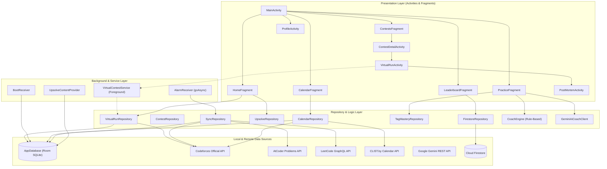

# Project Report: CodeArena
## A Real-Time Virtual Contest Simulator, Multi-Platform Practice Tracker, and AI Coach for Competitive Programmers

**Course:** CSE 2200 Advanced Programming Laboratory  
**Department:** Computer Science and Engineering, Khulna University of Engineering & Technology (KUET)  
**Author:** Individual Android Studio Project  
**Toolchain:** Android Studio Dolphin (2021.3.1), Java 1.8, AGP 7.3.1, Gradle 7.4  

---

## 1. Abstract & Problem Statement

Competitive programming demands disciplined contest practice, timely post-contest upsolving, and balanced coverage across diverse algorithmic categories (e.g., Dynamic Programming, Graph Theory, Combinatorics). However, student competitors face three pervasive challenges:
1. **Contest Environment Disconnect:** Solving individual problems asynchronously does not replicate the intense psychological pressure, countdown constraints, and penalty calculations of real contests.
2. **Upsolve Neglect & Weakness Blindness:** Problems missed during contests are rarely revisited systematically. Without spaced repetition, competitors fail to retain hard-won insights.
3. **Platform Fragmentation:** Practice history is split across Codeforces, AtCoder, and LeetCode, preventing students from tracking aggregate practice volume or seeing an accurate, single measure of their skill progression.

**CodeArena** addresses these problems with an offline-first Android application featuring:
* A **Virtual Contest Simulator** using a background `ForegroundService` and `CircularTimerView` for countdowns and automated live verdict evaluation.
* An **Upsolve Tracker** implementing spaced repetition (1, 3, 7, 14 days) via exact `AlarmManager` reminders that survive device reboots.
* An **ELO-based Practice Rating Engine** aggregating multi-platform accepted submissions into a unified skill metric.
* Visual analytics (radar, weakness bar, score progression charts) coupled with an offline rule engine and **Google Gemini AI** coaching explanations.

---

## 2. System Architecture

CodeArena employs a modular repository architecture separating UI components from persistent local storage (Room SQLite) and remote REST/GraphQL data sources.

---

## 3. Syllabus Topic Mapping

Every requirement from the CSE 2200 laboratory syllabus is implemented cleanly in dedicated classes:

| Syllabus Requirement | Target Implementation Class | Technical Explanation |
|---|---|---|
| **Activity Lifecycle** | `VirtualRunActivity.java` | Logs all 8 lifecycle events (`onCreate`, `onStart`, `onResume`, `onPause`, `onStop`, `onRestart`, `onDestroy`, `onSaveInstanceState`); gracefully restores elapsed state after configuration changes and process termination. |
| **Foreground Service** | `VirtualContestService.java` | Manages ongoing virtual contest countdowns; displays ongoing notifications with `BigTextStyle`; broadcasts periodic tick intents. |
| **BroadcastReceivers** | `AlarmReceiver.java`, `BootReceiver.java` | Handles contest alarms, upsolve reminders, and background multi-platform synchronization using `goAsync()`; restores pending alarms after device reboot (`ACTION_BOOT_COMPLETED`). |
| **AlarmManager** | `AlarmScheduler.java` | Implements Android 12+ (API 31) `canScheduleExactAlarms()` checking with `setExactAndAllowWhileIdle()` and fallback to `setAndAllowWhileIdle()`. |
| **Room Database** | `AppDatabase.java` | Contains 7 SQLite tables (`contests`, `problems`, `runs`, `run_problems`, `upsolve_items`, `solves`, `daily_stats`, `reminders`) with custom DAOs and indices. |
| **Custom Canvas View** | `CircularTimerView.java` | Subclasses `android.view.View`; implements custom attributes (`attrs.xml`); draws smooth anti-aliased background and progress rings using `Canvas.drawArc()`. |
| **XML Parsing** | `XmlTipParser.java`, `res/raw/tag_tips.xml` | Employs `XmlPullParser` to extract algorithmic tips and tactical advice from raw XML resources without external dependencies. |
| **Implicit Intents** | `PostMortemActivity.java`, `CalendarFragment.java` | Shares formatted contest outcomes via `Intent.ACTION_SEND`; views web problem statements via `Intent.ACTION_VIEW`; inserts events into the native calendar via `CalendarContract.Events.CONTENT_URI`. |
| **Explicit Intents** | `SplashActivity`, `MainActivity`, `ContestDetailActivity` | Navigates between application activities with strict bundle parameter passing. |
| **ContentProvider** | `UpsolveContentProvider.java` | Exposes pending spaced-repetition upsolve items at `content://com.kuet.codearena.provider/upsolve`. |
| **Networking & JSON** | `ApiClient.java`, Retrofit 2.9.0, Gson 2.9.0 | Consumes Codeforces and Gemini endpoints; features custom `RateLimiter` enforcing 2-second throttling between requests. |
| **Firebase Auth & Firestore** | `AuthManager.java`, `FirestoreRepository.java` | Supports Google Sign-In with credential exchange and real-time multi-platform leaderboard standings. |

---

## 4. Mathematical Formulations & Algorithms

### 4.1 Contest Scoring & Penalty Model
During a simulated virtual run, the score $S$ awarded for a set of solved problems $P$ is calculated dynamically taking problem rating, solve speed, and penalty attempts into account:

$$S = \sum_{p \in P} \left( R_p \times \max\left(0.3, 1 - \frac{t_{\text{solve}}}{t_{\text{contest}}}\right) \right) - 50 \times W$$

Where:
* $R_p$: The official Codeforces rating of problem $p$ (fallback: 800).
* $t_{\text{solve}}$: Elapsed time from contest start to the first accepted submission (in minutes).
* $t_{\text{contest}}$: Total contest duration (in minutes).
* $W$: Total wrong attempts submitted before the first accepted verdict across all solved problems.

### 4.2 ELO-Based Practice Rating Algorithm
Every newly solved problem across any supported platform triggers an ELO rating adjustment for the user's local Practice Rating ($R$), starting from an initial baseline of 800:

$$\text{Expected Score } E = \frac{1}{1 + 10^{\frac{p - R}{400}}}$$

$$R_{\text{new}} = \max\left(0, R + K \times (1 - E)\right)$$

Where:
* $p$: The difficulty rating of the solved problem.
* $K = 20$: The sensitivity factor.
* **Penalty Decay:** If an upsolve queue item expires without being solved after its 14-day interval, a penalty of 5 points is subtracted: $R_{\text{new}} = \max(0, R - 5)$.

### 4.3 Spaced Repetition Scheduling
Unsolved problems from finished contests are automatically enqueued into an exponential review cycle:
$$\text{Intervals} \in \{1 \text{ day}, 3 \text{ days}, 7 \text{ days}, 14 \text{ days}\}$$

Each successful verification marks the step complete and schedules the subsequent interval.

---

## 5. Engineering Design Decisions

1. **AlarmManager vs. WorkManager:** The course specification expressly prohibits WorkManager. `AlarmManager` with `setExactAndAllowWhileIdle()` and `goAsync()` BroadcastReceivers was implemented to ensure millisecond-precise reminders and reliable daily background syncing.
2. **Offline-First Resilience:** All network repositories verify local cache first. If external APIs (Codeforces, AtCoder, LeetCode, Gemini) fail or internet connectivity drops, cached records are returned and the UI gracefully updates without throwing unhandled exceptions.
3. **Canvas Custom View:** Instead of importing heavyweight third-party progress rings, `CircularTimerView` was engineered from scratch using `android.graphics.Paint` and `Canvas`. This reduces APK size and guarantees 60 FPS redraw performance.
4. **Rate Limiting:** Codeforces enforces a strict 1 request per 2 seconds rule. The custom `RateLimiter` ensures synchronization across all threads to prevent HTTP 429 errors.

---

## 6. Limitations & Future Work

* **AtCoder & LeetCode Official Auth:** Unofficial community endpoints are utilized for AtCoder and LeetCode since neither platform offers open OAuth2 login for third-party mobile clients.
* **Compiler Playground:** Future iterations could embed an in-app code editor and remote execution engine (e.g., Judge0) to allow solving problems directly inside the application.
